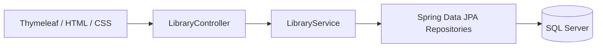

# 📚 Kütüphane Otomasyonu


Kitap koleksiyonunu, üyeleri ve ödünç/iade işlemlerini tek bir Türkçe yönetim panelinden takip etmeyi sağlayan Java ve Spring Boot uygulaması.

Veriler **Microsoft SQL Server** üzerinde saklanır. Uygulama, **Windows Authentication** ile mevcut Windows hesabı üzerinden bağlanır. Testler ayrı bir H2 veritabanında çalışır.

## Özellikler

- **Kitap yönetimi:** Ekleme, düzenleme, silme; kitap adı, yazar veya ISBN ile arama.
- **Üye yönetimi:** Ad soyad, e-posta ve isteğe bağlı telefon bilgileriyle kayıt yönetimi.
- **Stok takibi:** Toplam kopya sayısı ve ödünç verilebilecek kopyaların görüntülenmesi.
- **Ödünç ve iade:** Üye ve kitap seçimi, son iade tarihi, işlem geçmişi ve geciken iadeler.
- **Yönetim paneli:** Kitap başlığı, üye, aktif ödünç ve geciken iade sayıları.
- **Alan doğrulama:** Zorunlu alanlar, uzunluk sınırları, e-posta/telefon formatı ve adet kontrolleri.
- **Anlaşılır hata mesajları:** Alanların yanında Türkçe açıklamalar; hatalı gönderimlerde form bilgilerinin korunması.

### İş kuralları

Stok bulunmadan ödünç verilemez. Aynı üye aynı kitabı iade etmeden tekrar ödünç alamaz. Geçmiş iade tarihi ve tekrar iade işlemleri reddedilir. Toplam kopya sayısı ödünçteki kopya sayısından az olamaz.

Ödünç geçmişi olan kitaplar ve üyeler silinmez; böylece geçmiş kayıtların ilişkileri korunur. Transaction yönetimi ve pessimistic locking, eşzamanlı işlemlerde stok ve iade tutarlılığını destekler.

## Teknolojiler

| Katman | Teknolojiler |
|---|---|
| Backend | Java 17, Spring Boot 4.1.1, Spring MVC |
| Veri erişimi | Spring Data JPA, Hibernate, Microsoft JDBC Driver |
| Veritabanı | Microsoft SQL Server, Windows Authentication |
| Arayüz | Thymeleaf, HTML, CSS |
| Doğrulama | Jakarta Bean Validation |
| Derleme | Gradle Wrapper |
| Test | JUnit, Spring Boot Test, H2 |

## Mimari



Controller form isteklerini ve hata mesajlarını yönetir. Service iş kurallarını ve transaction sınırlarını uygular. Repository sınıfları veritabanı erişimini, entity sınıfları tablo ilişkilerini tanımlar.

### Veri modeli

| Tablo | İçerik |
|---|---|
| `dbo.book` | Kitap adı, yazar, ISBN, toplam kopya sayısı |
| `dbo.library_member` | Üye adı, e-posta, telefon |
| `dbo.loan` | Kitap/üye ilişkisi, ödünç tarihi, son iade tarihi, gerçekleşen iade tarihi |

Bir kitap ve bir üye birden fazla ödünç kaydıyla ilişkilendirilebilir. SQL Server metin sütunları Türkçe karakter desteği için `NVARCHAR` kullanır.

## Kurulum

### Gereksinimler

- Java 17 JDK
- Windows x64 ve çalışan bir SQL Server kurulumu
- Windows Authentication ile veritabanına erişebilen bir Windows hesabı
- İlk Gradle bağımlılık indirmeleri için internet bağlantısı

Uygulama SQL Server 2012 Express ile doğrulanmıştır; bu kurulum için Hibernate `SQLServerLegacyDialect` kullanır. Ayrı bir Gradle kurulumu gerekmez.

### 1. Depoyu klonlayın

```powershell
git clone https://github.com/MustafaBurakPala/kutuphane-otomasyonu.git
cd kutuphane-otomasyonu
```

### 2. SQL Server veritabanını hazırlayın

SSMS'de sunucunuza **Windows Authentication** ile bağlanın. SQL Server Express için örnek sunucu adı: `.\SQLEXPRESS`.

Yeni bir sorguda:

```sql
CREATE DATABASE Kutuphane;
GO
USE Kutuphane;
GO
```

Ardından **Kutuphane** veritabanı seçiliyken [database/sqlserver-schema.sql](database/sqlserver-schema.sql) dosyasını çalıştırın. Dosya yalnızca şema içerir; gerçek kitap, üye veya ödünç verisi içermez. Var olan tabloların üzerine yazılmasını engelleyen kontrolü vardır.

SQL Server Configuration Manager'da ilgili instance için TCP/IP'yi etkinleştirin. Yerel geliştirme için `127.0.0.1` üzerinde örneğin `14330` portunu kullanın ve SQL Server servisini yeniden başlatın. Farklı bir port kullanıyorsanız bağlantı adresini buna göre değiştirin.

### 3. Yerel bağlantı ayarını oluşturun

```powershell
Copy-Item src/main/resources/application-local.properties.example src/main/resources/application-local.properties
```

Yeni dosyadaki port ve veritabanı adını kendi kurulumunuza göre düzenleyin. Yerel dosya otomatik yüklenir ve `.gitignore` tarafından dışlanır.

```properties
spring.datasource.url=jdbc:sqlserver://localhost:14330;databaseName=Kutuphane;integratedSecurity=true;authenticationScheme=NativeAuthentication;encrypt=true;trustServerCertificate=true
```

Windows Authentication kullanıldığı için kullanıcı adı veya parola yazılmaz. `trustServerCertificate=true` yerel geliştirmede SQL Server'ın kendi sertifikasını kabul etmek için kullanılır; paylaşılan temel ayarda sertifika doğrulaması açıktır. Uygun sertifikaya sahip ortamlarda `trustServerCertificate=false` kullanın.

Yerel dosya yerine `DB_URL` ortam değişkeni de kullanılabilir. Yerel dosya varsa buradaki URL önceliklidir.

### 4. Uygulamayı çalıştırın

```powershell
.\gradlew.bat bootRun
```

Gradle, Windows Authentication için gerekli DLL'yi `native/` klasörüne indirir ve Java'nın native library yoluna ekler. DLL dosyası depoya dahil edilmez.

**Uygulama adresi:** http://127.0.0.1:8080/

IntelliJ IDEA'da proje klasörünü açın, Gradle yüklemesini tamamlayın ve Java 17 SDK seçin. Paylaşılan **Kutuphane** çalıştırma ayarı aynı `bootRun` görevini başlatır.

> `DemoApplication` sınıfını ayrı bir Java yapılandırmasıyla başlatırsanız Windows Authentication DLL yolunu ayrıca belirtmeniz gerekir. Hazır **Kutuphane** ayarını kullanmak bu adımı otomatikleştirir.

## Testler

```powershell
.\gradlew.bat test
.\gradlew.bat build
```

Testler için SQL Server kurulumu ve Windows Authentication bağlantısı gerekmez. Test verileri, gerçek veritabanından ayrı H2 veritabanlarında tutulur.

**9 otomatik test**; uygulama başlangıcını, kitap/üye/ödünç/iade akışını, stok ve kayıt geçmişi kurallarını, hatalı alanları, tekrar eden ISBN'yi, tarih doğrulamasını ve eşzamanlı çift iade senaryosunu kapsar.

HTML test raporu: `build/reports/tests/test/index.html`.

## Dosya yapısı

```text
src/main/java/com/example/demo/
  Book.java, Member.java, Loan.java    # Entity sınıfları
  *Repository.java                    # Veritabanı erişimi
  LibraryService.java                 # İş kuralları ve transaction yönetimi
  LibraryController.java              # Form istekleri ve hata yönetimi
  LoanForm.java                       # Ödünç formu doğrulaması
src/main/resources/
  templates/                          # Thymeleaf sayfaları
  static/style.css                    # Arayüz stilleri
  application.properties              # Paylaşılabilir temel yapılandırma
src/test/                             # Otomatik testler
database/                             # SQL Server şeması ve okuma sorguları
.run/                                 # Paylaşılan IntelliJ çalıştırma ayarı
```

## Paylaşım ve yapılandırma

`.gitignore`; yerel veritabanlarını, SQL Server veri/yedek dosyalarını, bağlantı ve gizli bilgi dosyalarını, IDE ayarlarını, Gradle önbelleğini, derleme çıktılarını, günlükleri ve native DLL dosyalarını dışlar. Gradle Wrapper JAR'ı, projeyi derlemek için gerektiğinden depoda tutulur.

Uygulama başlangıçta tablo şemasını `ddl-auto=validate` ile doğrular. Entity yapısı değişirse gerekli SQL şema geçişleri ayrıca uygulanmalıdır.

Bu sürüm yerel kullanım ve öğrenme/portföy amacıyla hazırlanmıştır. Uygulama içi kullanıcı girişi ve rol tabanlı yetkilendirme henüz yoktur; varsayılan web bağlantısı yalnızca `127.0.0.1` adresinde dinler.
